# Rota Auto

**Android Auto no painel Tripper Dash de motos Royal Enfield compatíveis.**

Português (Brasil) · [English](README.md)

**[Baixar o APK](https://github.com/MatheusCastellar/Rota-Auto/releases/latest)**

Feito por **Matheus Castellar**. Projeto gratuito, da comunidade e sem fins lucrativos, desenvolvido para motociclistas, sem exigir conta no Rota Auto. Versão atual do código: **0.1.47**.

O Rota Auto recebe o vídeo do Android Auto no celular e o transmite pela rede Wi-Fi da moto para o Tripper Dash. Mapas e aplicativos de mídia compatíveis funcionam pelo Android Auto; o Rota Auto cuida da conexão, da adaptação da imagem e dos comandos da moto. Este é o projeto principal com Android Auto, não um aplicativo independente do SDK do Google Maps.

## Disponível em quatro idiomas

**🇧🇷 Português (Brasil) · 🇺🇸 🇬🇧 English · 🇪🇸 Español · 🇮🇳 हिन्दी (Hindi)**

Escolha o idioma do aplicativo pelo **botão de bandeira ao lado de Ajustes**. A documentação do projeto está disponível em português e inglês.

<a href="docs/images/app-languages.png">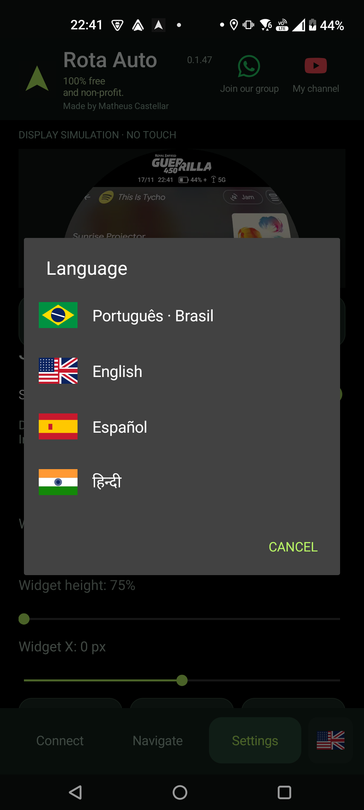</a>

## Na moto

Fotos reais do Rota Auto funcionando em uma Guerrilla 450. A **logo Guerrilla, o widget de informações e o enquadramento são personalizações opcionais**, não a aparência padrão.

<table>
  <tr><th>Spotify</th><th>Mapa e música juntos</th></tr>
  <tr>
    <td><a href="docs/images/dashboard-spotify.jpg">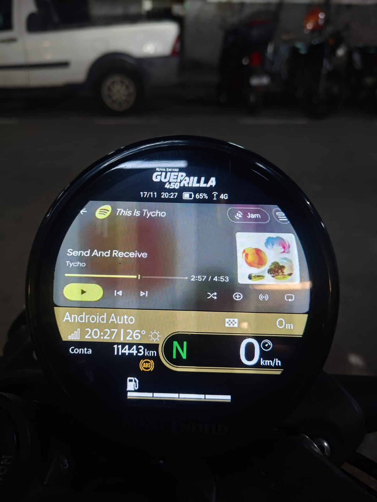</a></td>
    <td><a href="docs/images/dashboard-maps-music.jpg">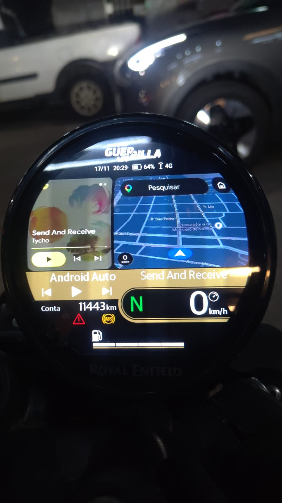</a></td>
  </tr>
</table>

## No aplicativo

Capturas novas, feitas diretamente no celular em **17/11/2026**, com a versão **0.1.47** e a **interface em inglês**, nas duas versões deste README. Toque nas imagens para ampliar. As ações e os valores exibidos são exemplos personalizáveis, não os padrões de fábrica.

<table>
  <tr><th>Conectar</th><th>Perfis e modos de controle</th><th>Comandos personalizados</th></tr>
  <tr>
    <td><a href="docs/images/app-connect.png">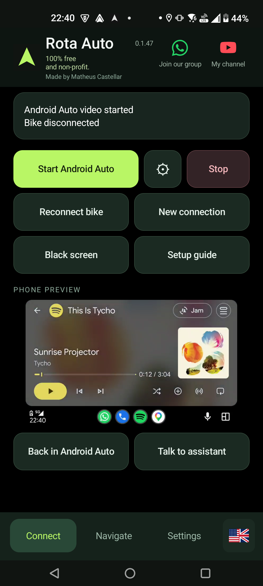</a></td>
    <td><a href="docs/images/app-menu-settings.png">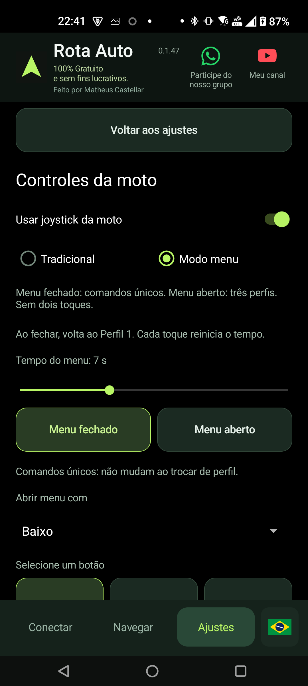</a></td>
    <td><a href="docs/images/app-controls.png">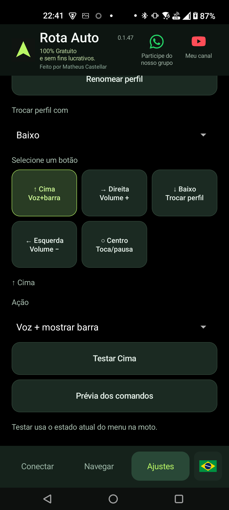</a></td>
  </tr>
</table>

<details>
<summary>Ver a prévia circular dos comandos</summary>

<a href="docs/images/app-command-preview.png">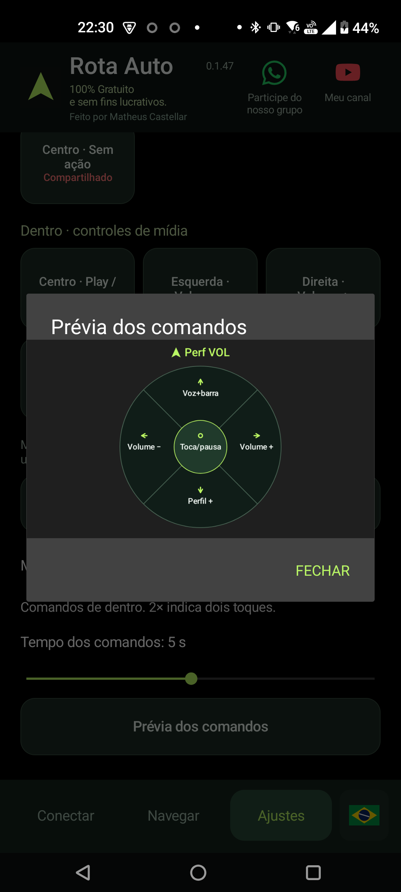</a>

</details>

## Personalização do painel

Ajuste enquadramento, distorção, tamanho e posição da imagem, logo da moto e widget de informações. Logo e widget são opcionais. As capturas mostram a prévia funcionando e o simulador do painel com o Spotify, sem divulgar localização. A logo Guerrilla e o widget exibidos são personalizações opcionais.

<table>
  <tr><th>Enquadramento e distorção</th><th>Logo da moto</th><th>Widget de informações</th></tr>
  <tr>
    <td><a href="docs/images/app-geometry.png">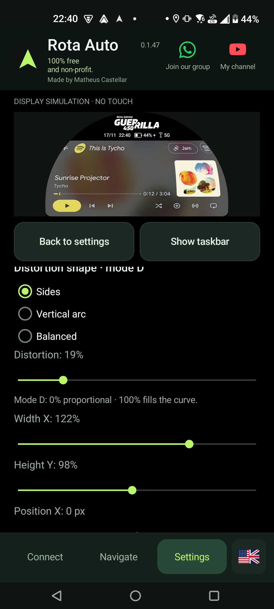</a></td>
    <td><a href="docs/images/app-logo.png">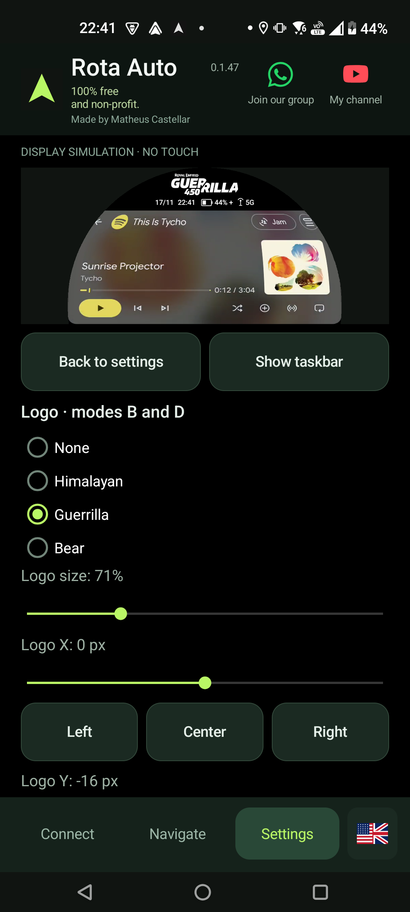</a></td>
    <td><a href="docs/images/app-widget.png">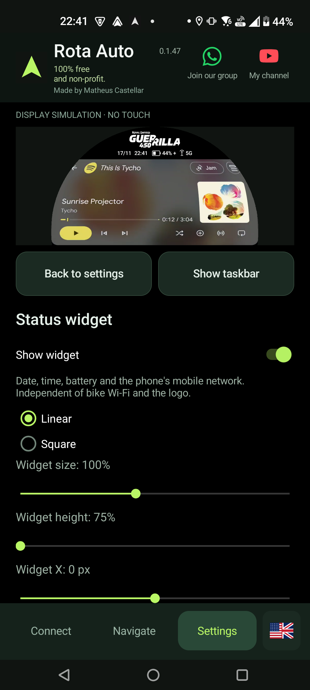</a></td>
  </tr>
</table>

<details>
<summary>Ver opções da barra e modos de imagem</summary>

<a href="docs/images/app-customization.png">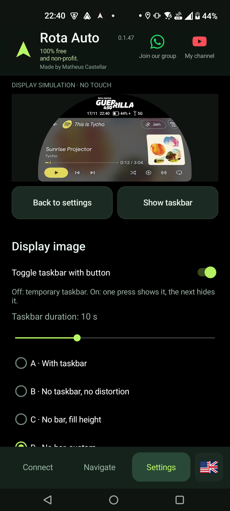</a>

</details>

## Recursos


- Busca e reconexão ao Wi-Fi da moto, com prévia interativa no celular.
- Ajustes de FPS, taxa de vídeo, enquadramento, barra de tarefas e simulador do painel.
- Logo da moto e widget de data, hora, bateria e rede móvel opcionais, com ajustes de posição.
- Três perfis de comandos personalizáveis, entradas separadas de mapa/mídia e menu circular opcional com três perfis.
- Atalhos de aplicativos, assistente de voz, controles de música e letreiro da faixa em reprodução.
- Manobras e distâncias quando informadas pelo Android Auto; círculo nativo de navegação opcional.
- Modo dia/noite do mapa e importação/exportação das configurações.
- Interface em português brasileiro, inglês, espanhol e hindi.

O áudio pode continuar no celular ou no intercomunicador conectado. O comportamento disponível depende do celular, da versão do Android Auto, dos aplicativos instalados e do firmware do painel.

## Requisitos e primeiros passos

- Android **10 ou superior**, com Android Auto instalado e funcionando.
- **Tripper Dash com Wi-Fi** compatível. O Tripper antigo, que usa apenas Bluetooth, é outro dispositivo.
- Instale o Rota Auto e conceda as permissões necessárias aos recursos que utilizar.

1. Abra as configurações do Android Auto no celular. Toque dez vezes em **Versão** para liberar o menu de desenvolvedor do Android Auto.
2. No menu (⋮) da tela principal das configurações do Android Auto, escolha **Iniciar servidor da unidade principal**.
3. Abra o Rota Auto, toque em **Ligar Android Auto** e conecte à rede `RE_` da moto. Para uma moto já selecionada, use **Reconectar Moto**.
4. Defina a rota pelo Google Maps ou outro navegador compatível. Ajuste os comandos e a imagem nas configurações do Rota Auto.

Os nomes dos menus podem variar conforme idioma e versão. A opção do servidor fica no **Android Auto**, não nas opções de depuração USB do Android. A conexão Wi-Fi com a moto não exige cabo USB. Alguns celulares se comportam de forma diferente ao bloquear a tela; o tutorial do aplicativo explica a alternativa de ativar a depuração USB nos aparelhos afetados, mas isso não é necessário em todos os modelos.

## Limitações conhecidas

- É um receptor **não oficial**, sem certificação do Google ou da Royal Enfield. Atualizações podem alterar a compatibilidade.
- Ocultar o círculo nativo de navegação pode impedir o envio de alguns comandos do mapa pelo painel. Não é apenas uma mudança visual.
- Atraso e fluidez dependem da codificação, do Wi-Fi e do processamento do painel. O padrão é **4 fps**.
- Alguns atalhos para abrir aplicativos dependem do layout do Android Auto. Nem todos os aplicativos oferecem o mesmo comportamento.
- Confira funcionamento com tela apagada, intercomunicador e reconexão no seu conjunto de celular e moto. Faça configurações e testes com a moto parada.

## Compilar o projeto

Abra esta pasta no Android Studio, instale o **Android SDK 36** e selecione um **JDK 17 ou superior** compatível com o Gradle. O projeto inclui o Gradle wrapper 9.4.1 e usa Android Gradle Plugin 9.2.1.

Configure o caminho do SDK pelo Android Studio ou em um arquivo local `local.properties`, que não deve ser publicado. Execute:

```sh
./gradlew testDebugUnitTest assembleDebug
```

No Windows, use `gradlew.bat`. O APK de depuração fica em `app/build/outputs/apk/debug/`. As chaves de assinatura de distribuição não estão incluídas; um APK assinado com outra chave não pode atualizar uma instalação assinada pelo autor.

## Contribuições e privacidade

Relate problemas nas Issues do GitHub, indicando versões do Rota Auto/Android, modelo do painel e como reproduzir. Antes de publicar registros ou imagens, remova localização, nomes de redes, dados de contas e outras informações pessoais. Não publique chaves de API ou de assinatura.

O código inclui um **certificado e uma chave públicos de interoperabilidade do receptor**, herdados do Open Headunit (`res/raw/cert` e `res/raw/privkey`). São arquivos de referência do protocolo, não credenciais privadas de assinatura do autor. APKs originais da Royal Enfield, firmwares, credenciais extraídas e diagnósticos pessoais não fazem parte deste repositório.

## Licença e créditos

Distribuído sob **GNU AGPL v3**; consulte [LICENSE](LICENSE). As atribuições e licenças dos componentes estão em [NOTICE](NOTICE) e [licenses/](licenses/).

Agradecimentos a [OpenDash](https://github.com/Nukeio/open-dash), [NorthStar](https://github.com/adityadasika21/NorthStar), [better-dash](https://github.com/norbertFeron/better-dash), [Open Headunit](https://github.com/andreknieriem/open-headunit), [WayFindR Dash Bridge](https://github.com/1857rebels/WayFindR-Dash-Bridge) e [Bootstrap Icons](https://github.com/twbs/icons). O NOTICE informa revisões, autores e quais componentes foram aproveitados.

Royal Enfield, logos dos modelos, Android Auto, Google Maps, WhatsApp e YouTube pertencem aos respectivos titulares. A licença do código não concede direitos sobre essas marcas. O projeto não é afiliado nem endossado por essas empresas.

[Grupo de testes no WhatsApp](https://chat.whatsapp.com/C5hLBC3MRAWK0Avu2F1eXS) · [Canal do Matheus no YouTube](https://www.youtube.com/@Castellar450)
